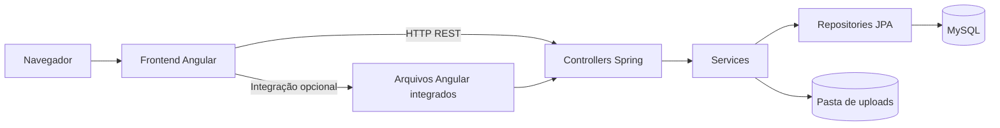
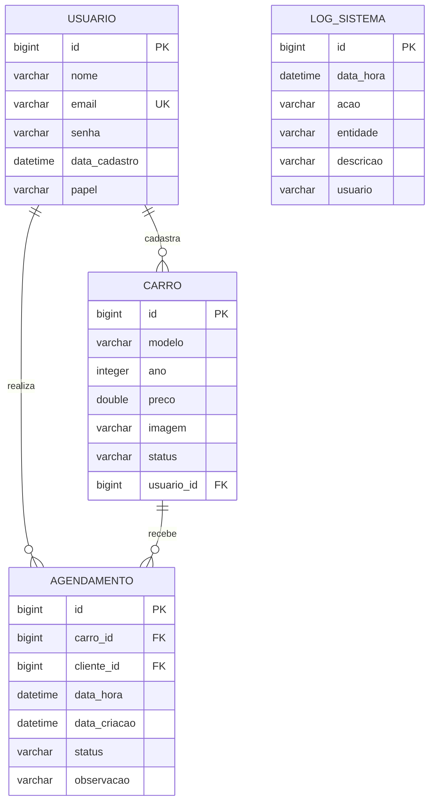
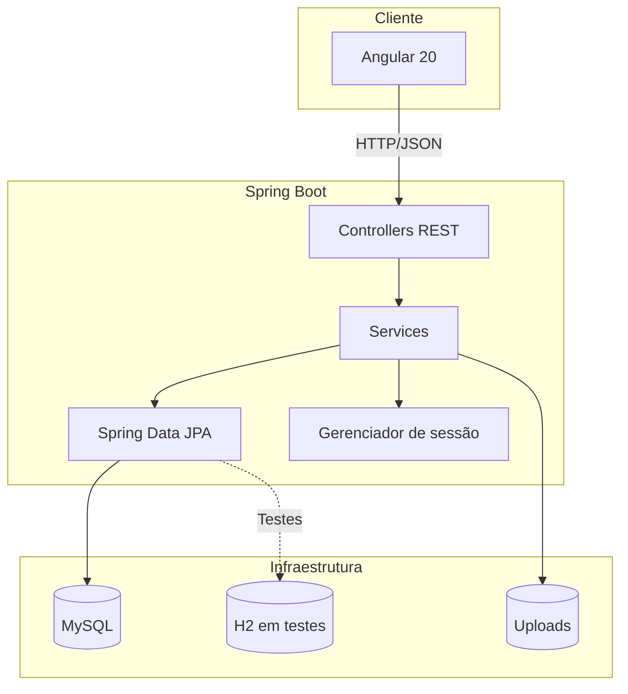

# TSI Loja de Carro

Sistema web para consulta e gerenciamento de veículos, cadastro de usuários, controle de permissões e agendamento de test drives.

O sistema possui perfis de usuário e administrador. Usuários comuns podem manter seus dados, cadastrar veículos associados à própria conta e agendar test drives. Administradores podem gerenciar usuários, veículos, agendamentos e logs.

## Como rodar o projeto

### Opção recomendada: Docker Compose

Pré-requisitos:

- Docker Desktop
- Docker Compose

Na raiz do projeto, execute:

```powershell
docker compose up --build
```

A aplicação estará disponível em:

```text
http://localhost:8080
```

Para encerrar:

```powershell
docker compose down
```

Os dados do MySQL e das imagens enviadas são mantidos nos volumes `mysql_data` e `app_uploads`.

### Desenvolvimento local

Pré-requisitos:

- Java 25
- Maven 3.9+ ou o Maven Wrapper incluído
- Node.js 20+ e npm
- MySQL 8

#### 1. Criar o banco

```sql
CREATE DATABASE carros CHARACTER SET utf8mb4 COLLATE utf8mb4_unicode_ci;
```

#### 2. Executar o backend

Na raiz do projeto:

```powershell
$env:SERVER = "dev"
.\mvnw.cmd spring-boot:run
```

Backend:

```text
http://localhost:8080
```

#### 3. Executar o frontend separadamente

Em outro terminal:

```powershell
cd frontend
npm install
npm start
```

Frontend:

```text
http://localhost:4200
```

O Angular encaminha `/usuario`, `/carro`, `/agendamento`, `/log` e `/uploads` para `http://localhost:8080`.

#### Executar frontend integrado ao backend

```powershell
cd frontend
npm install
npm run build
cd ..
$env:SERVER = "dev"
.\mvnw.cmd spring-boot:run
```

Acesse `http://localhost:8080`. Os arquivos Angular são gerados em `src/main/resources/static`.

## Tecnologias utilizadas

- Java 25
- Spring Boot 3.5.7
- Spring Web
- Spring Data JPA / Hibernate
- Maven
- MySQL 8
- H2 para testes
- Angular 20
- TypeScript
- RxJS
- Docker e Docker Compose
- Springdoc OpenAPI

## Arquitetura da aplicação



A aplicação segue uma arquitetura em camadas:

- `controllers`: recebe e valida as requisições REST.
- `services`: implementa regras de negócio e controle de sessão.
- `repositories`: realiza o acesso aos dados com Spring Data JPA.
- `model`: representa entidades e enumerações persistidas.
- `frontend`: interface Angular e chamada dos endpoints REST.

## Executar o backend

### Perfil de desenvolvimento

```powershell
$env:SERVER = "dev"
.\mvnw.cmd spring-boot:run
```

### Perfil de produção local ou via JVM

```powershell
$env:SERVER = "prod"
.\mvnw.cmd spring-boot:run
```

O Maven Wrapper pode ser substituído por `mvn` caso o Maven já esteja instalado.

## Executar o frontend

```powershell
cd frontend
npm install
npm start
```

Para gerar o build de produção integrado ao backend:

```powershell
cd frontend
npm run build
```

## Configuração do banco de dados

O banco padrão do perfil `dev` é:

| Configuração | Valor |
|---|---|
| Host | `localhost` |
| Porta | `3306` |
| Banco | `carros` |
| Usuário | `root` |
| Senha | `root` |

A configuração fica em [application-dev.properties](src/main/resources/application-dev.properties). O Hibernate utiliza `ddl-auto=update`, criando ou atualizando as tabelas automaticamente.

No Docker Compose, o MySQL recebe `MYSQL_DATABASE=carros`, `MYSQL_ROOT_PASSWORD=root` e é publicado na porta `3306`.

Os testes usam H2 em memória e não alteram o banco MySQL. A configuração está em [application.properties](src/test/resources/application.properties).

## Variáveis de ambiente necessárias

| Variável | Finalidade | Padrão |
|---|---|---|
| `SERVER` | Perfil Spring: `dev` ou `prod` | `dev` |
| `UPLOADS_DIR` | Diretório de imagens dos veículos | `uploads` |
| `SPRING_DATASOURCE_URL` | URL JDBC do banco | Perfil de execução |
| `SPRING_DATASOURCE_USERNAME` | Usuário do banco | Perfil de execução |
| `SPRING_DATASOURCE_PASSWORD` | Senha do banco | Perfil de execução |

Exemplo PowerShell:

```powershell
$env:SERVER = "prod"
$env:SPRING_DATASOURCE_URL = "jdbc:mysql://localhost:3306/carros"
$env:SPRING_DATASOURCE_USERNAME = "root"
$env:SPRING_DATASOURCE_PASSWORD = "sua-senha-local"
$env:UPLOADS_DIR = "uploads"
.\mvnw.cmd spring-boot:run
```

Não utilize senhas reais de produção neste repositório.

## Diagramas

### Diagrama entidade-relacionamento



`LogSistema` representa um histórico textual e não possui chave estrangeira para usuário, preservando o registro caso a conta seja excluída.

### Diagrama de arquitetura



## Documentação da API REST

Com o backend em execução, a documentação interativa Swagger/OpenAPI está disponível em:

- Swagger UI: `http://localhost:8080/swagger-ui/index.html`
- Especificação OpenAPI: `http://localhost:8080/v3/api-docs`

Principais endpoints:

| Método | Caminho | Descrição |
|---|---|---|
| `POST` | `/usuario/salvar` | Criar usuário |
| `PUT` | `/usuario/{id}` | Atualizar usuário |
| `DELETE` | `/usuario/{id}` | Excluir usuário |
| `GET` | `/usuario/{id}` | Buscar usuário |
| `GET` | `/usuario/listarUsuarios` | Listar usuários |
| `POST` | `/usuario/login` | Autenticar usuário |
| `POST` | `/usuario/logout` | Encerrar sessão |
| `GET` | `/usuario/logado` | Consultar usuário da sessão |
| `POST` | `/carro/salvar` | Cadastrar veículo com imagem opcional |
| `PUT` | `/carro/{id}` | Atualizar veículo |
| `GET` | `/carro/meusCarros` | Listar veículos do usuário |
| `PUT` | `/carro/{id}/imagem` | Trocar imagem |
| `DELETE` | `/carro/{id}/imagem` | Remover imagem |
| `PUT` | `/carro/{id}/status` | Alterar status do veículo |
| `DELETE` | `/carro/{id}` | Excluir veículo |
| `GET` | `/carro/{id}` | Buscar veículo |
| `GET` | `/carro/listarCarros` | Listar veículos |
| `POST` | `/agendamento` | Criar agendamento |
| `GET` | `/agendamento/meus` | Listar agendamentos do cliente |
| `GET` | `/agendamento/disponibilidade` | Consultar horários disponíveis |
| `GET` | `/agendamento` | Listar agendamentos, com filtros opcionais |
| `PUT` | `/agendamento/{id}/cancelar` | Cancelar agendamento |
| `PUT` | `/agendamento/{id}/status` | Alterar status do agendamento |
| `GET` | `/log` | Listar logs do sistema |

## Executar os testes

### Testes backend

Na raiz do projeto:

```powershell
.\mvnw.cmd test
```

Os testes usam H2 em memória. Relatórios detalhados são gerados em `target/surefire-reports`.

### Testes frontend

```powershell
cd frontend
npm install
npm test -- --watch=false --browsers=ChromeHeadless
```

## Endereço da aplicação publicada

Nenhum endereço de publicação está configurado neste repositório. A URL oficial deverá ser preenchida após o deploy em ambiente de hospedagem.

Durante o desenvolvimento, os endereços são:

- Aplicação integrada: `http://localhost:8080`
- Frontend Angular separado: `http://localhost:4200`
- Swagger UI: `http://localhost:8080/swagger-ui/index.html`

## Credenciais de demonstração

As credenciais abaixo são fictícias e exclusivas para demonstração. Elas não são credenciais reais de produção e não devem ser usadas em ambientes reais.

| Perfil | E-mail | Senha |
|---|---|---|
| Administrador | `admin.demo@exemplo.local` | `Demo.Admin@2026` |
| Cliente | `cliente.demo@exemplo.local` | `Demo.Cliente@2026` |

Essas contas não são criadas automaticamente. Para utilizar o perfil administrador em um ambiente demonstrativo, crie a conta pela tela de cadastro e depois promova o usuário no MySQL:

```sql
UPDATE usuario SET papel = 'ADMIN'
WHERE email = 'admin.demo@exemplo.local';
```

Em seguida, faça login novamente. Contas públicas novas são criadas com o papel `USER`.
